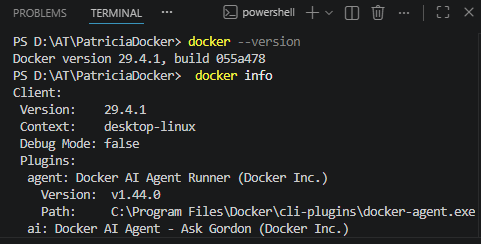
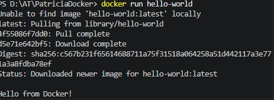
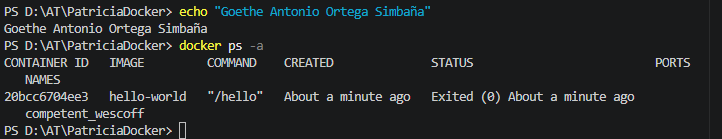
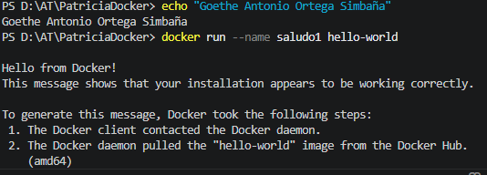
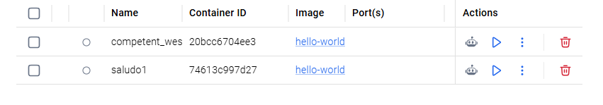
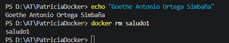
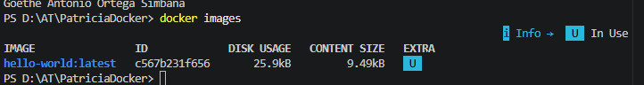
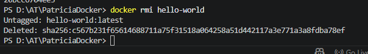

# Práctica Docker: Contenedores efímeros

**Alumno:** Goethe Antonio Ortega Simbaña

**Fecha:** 06/11/2026

## 1. Ejecutar el primer contenedor

### 1.1. Ejecución y descarga

El comando `docker run hello-world` permite
descargar la imagen si no está disponible
y ejecutar un contenedor que muestra un mensaje.

### 1.2. Reflexión

Docker muestra un mensaje de bienvenida
que confirma que el contenedor se ha ejecutado.

La imagen permanece almacenada localmente.
El contenedor termina su ejecución correctamente.

### 1.3. Verificación

El comando `docker ps -a` muestra todos
los contenedores, incluidos los detenidos.

**Container ID:** 20bcc6704ee3

**Status:** Exited (0)

## 2. Nombrar contenedores

### 2.1. Ejecución con nombre personalizado

El comando `docker run --name saludo1 hello-world`
ejecuta el contenedor asignándole un nombre.

### 2.2. Verificación

### 2.3. Reflexión

Asignar un nombre facilita identificar
y administrar los contenedores sin recordar
su identificador o nombre aleatorio.

## 3. Limpieza de contenedores

### 3.1. Eliminación

El comando `docker rm saludo1` elimina
el contenedor detenido.

### 3.2. Verificación

## 4. Limpieza de imágenes

### 4.1. Listar imágenes

El comando `docker images` muestra
las imágenes almacenadas localmente.

### 4.2. Eliminar imagen

El comando `docker rmi hello-world` elimina
la imagen del almacenamiento local.

### 4.4. Reflexión

`docker rm` elimina contenedores,
mientras que `docker rmi` elimina imágenes.

Si ejecutamos nuevamente `docker run hello-world`,
Docker tendrá que descargar la imagen otra vez
antes de crear y ejecutar el contenedor.

## 5. Conclusión

Hemos probado a crear contenedores, comprobar si siguen activos o ya han terminado, ponerles nuestros propios nombres y, por último, eliminar los contenedores y las imágenes que ya no necesitamos. Así hemos podido entender mejor cómo se trabaja con Docker y cómo gestionar sus recursos básicos.